# ტენდერ რადარი: UI/UX ანგარიში

**მთავარი დავალება:** მცირე სამშენებლო კომპანიის მენეჯერი ტელეფონით, ობიექტზე, 60 წამში პოულობს ტენდერს, რომელშიც ღირს მონაწილეობა, და იგებს, რა ფასი დაწეროს.

- ცოცხალი ვერსია: https://tender-radar-beta.vercel.app (commit `9befd68`)
- შეიცვალა მხოლოდ `index.html`. `data.json`, `pipeline.js`, `tg_post.js` ხელუხლებელია.
- გარე ბიბლიოთეკა და ანალიტიკა არ დამატებულა. Google Fonts მოიხსნა.
- თარიღი: 9 ნოემბერი 2026

## 1. Baseline vs შედეგი

| საზომი | ადრე | მერე |
|---|---|---|
| **Lighthouse mobile Performance**, 4x CPU, 5 გაშვების მედიანა | **66** | **87** |
| Performance, 2x CPU (ამ კომპიუტერისთვის კალიბრებული), მედიანა | 76 | 99 |
| **Accessibility** | 95 | **100** |
| Best Practices / SEO | 96 / 90 | 100 / 100 |
| TBT, 4x მედიანა | 2970 ms | 520 ms |
| LCP, 4x მედიანა | 1.6 s | 1.4 s |
| CLS, მედიანა | 0.14 | 0 |
| **axe-core** (serious/critical) | 1 serious (კონტრასტი, 95 ელემენტი) | **0** (ყველა მდგომარეობაში, ღია და მუქ თემაში) |
| გადმოსაწერი ზომა | 279 KiB (219 KiB ფონტები) | 60 KiB |
| index.html (brotli) | ~11 KiB | ~11.5 KiB |
| DOM ელემენტები | 2757 | 256 |
| გვერდის სიმაღლე 360px-ზე | 51 115 px | 3 536 px |
| პირველი ბარათის დასაწყისი 360px-ზე | 2270 px (3 ეკრანი) | 497 px (პირველ ეკრანზე) |
| ბარათის სიმაღლე | 747 px | 532 px |
| პირველი ბარათი ნელ 3G-ზე + 4x CPU | 10.5 s | 2.4 s |
| 44px-ზე პატარა ღილაკები | 194 | 0 (დარჩა მხოლოდ 3 ბმული ტექსტის შიგნით) |
| უმცირესი შრიფტი / ძირითადი ტექსტი | 10.5 / 15.5 px | 13 / 16 px |
| ჰორიზონტალური სქროლი 360px-ზე | 3 px | არ არის |

**მთავარი დავალება 360px-ზე (ნაბიჯები):**

| გზა | ადრე | მერე |
|---|---|---|
| ბარათი + ფასი + გახსნა | **6** (4 სქროლი, 2 დაჭერა) | **1** (0 სქროლი, 1 დაჭერა "გახსნაზე") |
| იგივე, მხოლოდ ჩემი სამუშაოს ტიპით | **11** (+5 დაჭერა კატეგორიების გამოსართავად) | **2** (+1 დაჭერა) |

360x740 ეკრანზე ფასის დიაპაზონი (ქვედა კიდე 736 px) პირველივე ეკრანზე ჩანს, ზღვარზე. უფრო დაბალ ეკრანზე ერთი მცირე სქროლი დასჭირდება.

### როგორ გაიზომა

- Lighthouse 13.6, mobile, simulated throttling (Slow 4G). "ადრე" = ძველი `index.html` ამ კომპიუტერზე, 5 გაშვება. "მერე" = ცოცხალი Vercel ვერსია, 5 გაშვება. ერთჯერადი გაზომვა ცოცხალ ძველ ვერსიაზე იყო 68 / 95.
- **Performance 90+ 4x-ზე არ შესრულდა: მედიანა 87** (84, 84, 87, 87, 90). ამ კომპიუტერის benchmarkIndex არის 400-850. Lighthouse-ის 4x ნაგულისხმევი მნიშვნელობა გათვლილია ~1500+ ინდექსის კომპიუტერზე, და თითქმის ცარიელ ქართულ გვერდსაც კი აქ 85-93 მოსდის. ამიტომ 2x შედეგიც ჩავწერე. PageSpeed Insights (Google-ის სერვერები) ვერ გავუშვი: დღის ლიმიტი ამოწურული იყო.
- axe-core 4.14 Playwright-ით, 360px-ზე, ყველა მდგომარეობაში: ჩვეულებრივი, მუქი თემა, ცარიელი, შეცდომა, უკიდურესი მონაცემები, 1280px.

## 2. ადრე / მერე სკრინშოტები

| | ადრე | მერე |
|---|---|---|
| 360px, პირველი ეკრანი | 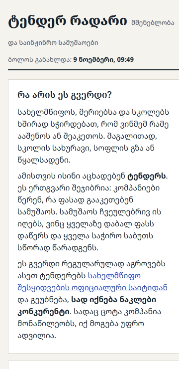 | 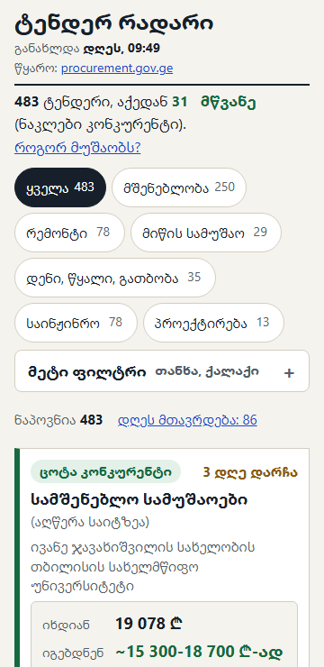 |
| ბარათი, ფასის ახსნა გახსნილი | 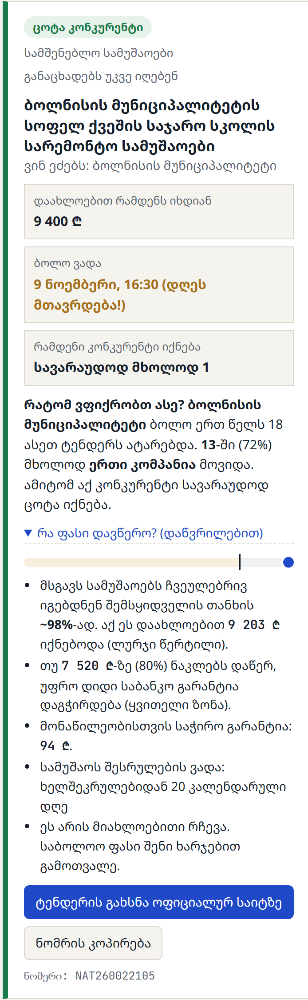 | 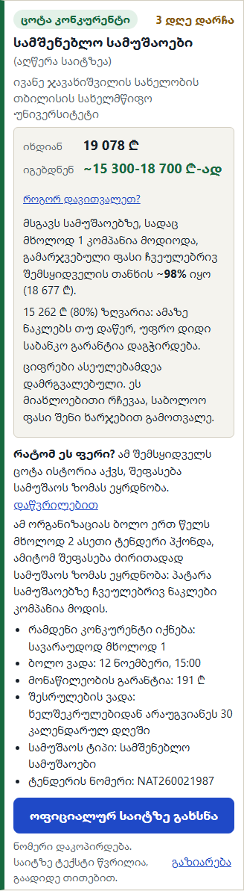 |
| 1280px | 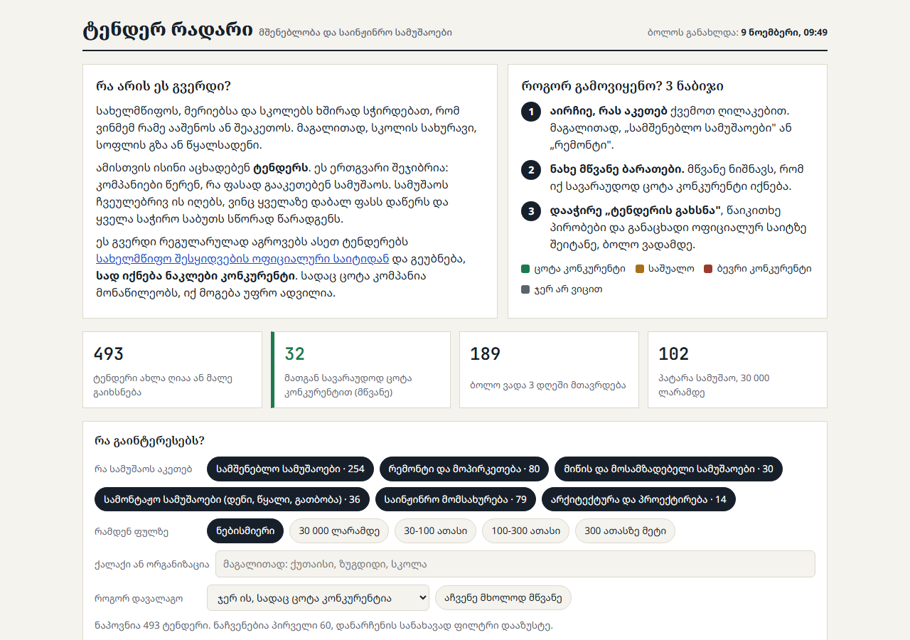 | 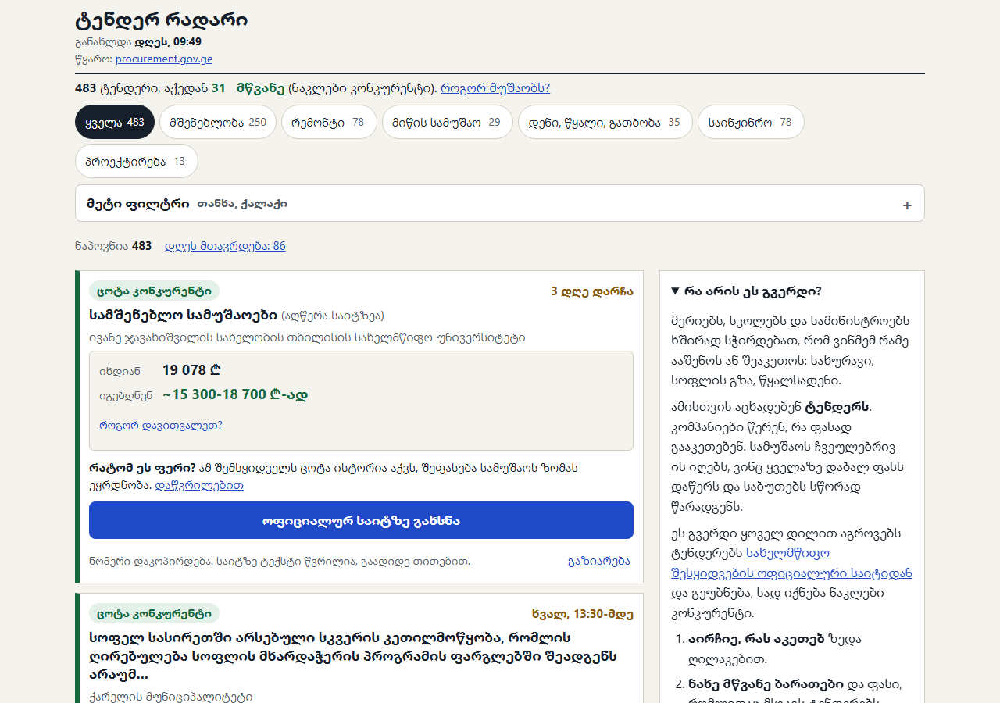 |
| ჩატვირთვისას (ნელ ქსელზე) | 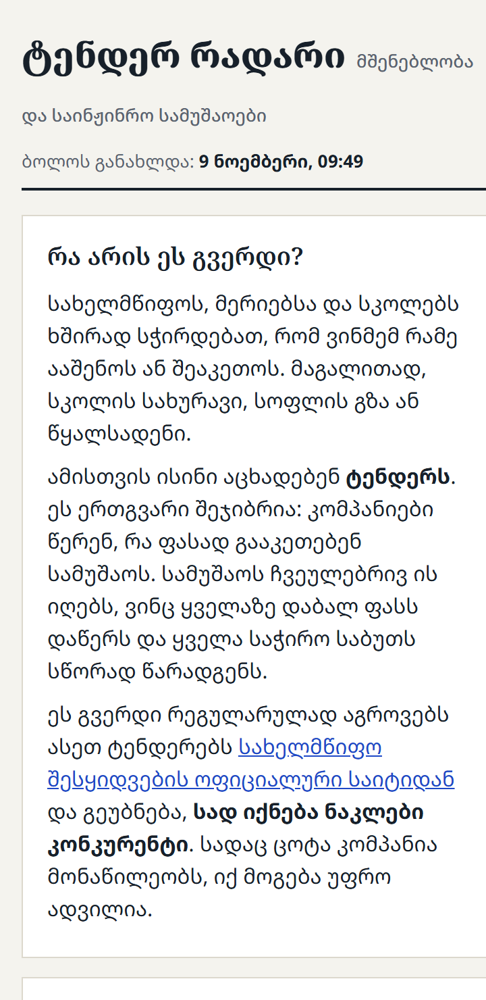 | 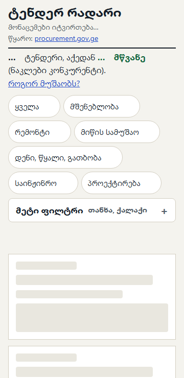 |

**მდგომარეობები (მერე):**

| ცარიელი (ფილტრებით) | შეცდომა + "სცადე თავიდან" | შეცდომის შემდეგ ხელახლა | გაზიარებული ბმული |
|---|---|---|---|
| 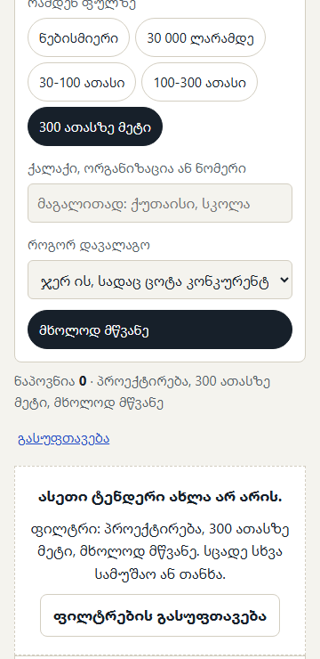 | 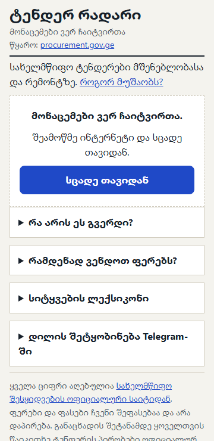 |  | 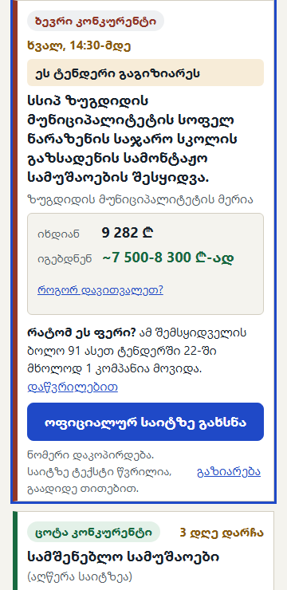 |

| უკიდურესი მონაცემები* | იგივე, მუქ თემაში | მუქი თემა | "როგორ მუშაობს" + footer |
|---|---|---|---|
| 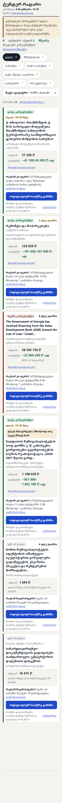 | 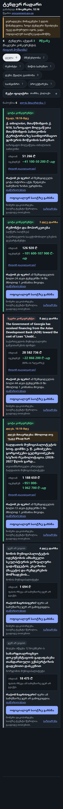 | 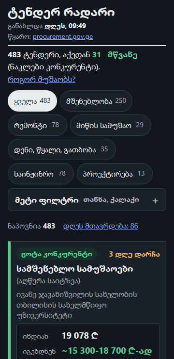 | 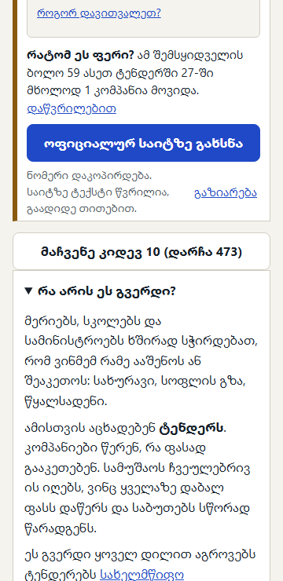 |

\* უკიდურესი ნაკრები აწყობილია რეალური სტრიქონებიდან: ყველაზე გრძელი აღწერა (120 სიმბოლო), ყველაზე გრძელი ორგანიზაცია (171), ცარიელი აღწერა, 34-სიმბოლოიანი სიტყვა, უდიდესი თანხა (28.6 მლნ ₾, wr = 0.8, ანუ ერთი ციფრი), უმცირესი თანხა (1 694 ₾), ნაცრისფერი კატეგორია, "მიღება იწყება", დღეს მთავრდება, და მონაცემები 3 დღის წინანდელია (ჩანს გაფრთხილება). სრული გვერდის სკრინშოტში ქვედა ნაწილი ცარიელია, რადგან "როგორ მუშაობს" და footer ტელეფონზე მხოლოდ სქროლისას იხატება (`content-visibility`). ეს ცალკე შემოწმდა: `info-footer.png`.

ოფიციალური პორტალი გადასვლის შემდეგ (360px): `report/before/portal-360.png`. ის დესკტოპის გვერდია (980px, ტექსტი ~5px) და განაცხადისთვის შესვლას ითხოვს.

## 3. რა გაკეთდა

1. **პირველი ბარათი პირველ ეკრანზე.** ზემოთ არის ერთი წინადადება, განახლების დრო, წყარო და სამუშაოს ტიპის ღილაკები. "რა არის ეს გვერდი", 3 ნაბიჯი, ლექსიკონი, ფერების შემოწმების ცხრილი და Telegram გადავიდა "როგორ მუშაობს?" ბლოკში (ტელეფონზე სიის ქვემოთაა, კომპიუტერზე მარჯვენა სვეტში).
2. **ბარათის იერარქია.** პირველ სტრიქონზეა ფერი და "3 დღე დარჩა" / "დღეს, 16:30-მდე", შემდეგ რა სამუშაოა და ვინ ეძებს, შემდეგ "იხდიან X ₾" და **"იგებდნენ ~X-Y ₾-ად"** ჩაკეცილი ახსნით "როგორ დავითვალეთ?". "რატომ ეს ფერი?" ერთ სტრიქონშია, დეტალები ჩაკეცილია. აღწერის გარეშე ბარათზე წერია "სამუშაოს ტიპი (აღწერა საიტზეა)". გრძელი სამინისტროს სახელიდან ჩანს ბოლო ნაწილი, სრული სახელი `title`-შია.
3. **ფასის დიაპაზონი** მხოლოდ არსებული ლოგიკიდანაა: ქვედა კიდე = 80%-ის ზღვარი (მაღლა დამრგვალებული, რომ ზღვარს ქვემოთ არ ჩავიდეს), ზედა = `est × wr`, ორივე ასეულებამდე. ნაცრისფერ კატეგორიებზე ფასი არ ჩანს. **გადახრა:** 40 ტენდერზე `wr = 0.8`, ანუ ორი კიდე ემთხვევა. იქ ჩანს ერთი ციფრი "(80%-ის ზღვარზე)", რადგან ახალი მოდელის შექმნა არ გინდოდა.
4. **დღეს დამთავრებული ტენდერები** "საუკეთესო შანსის" დალაგებაში ჯგუფის ბოლოს არიან, "დღეს მთავრდება: მხოლოდ თუ უკვე მზად ხარ" ნიშნით. არცერთი ფილტრი არ მალავს მათ (შემოწმდა "მხოლოდ მწვანეზეც"). ზედა ხაზზე არის ღილაკი "დღეს მთავრდება: N", რომელიც ვადით ალაგებს. ჩანს მხოლოდ ის, რისი ვადაც ჯერ არ გასულა (ისე, როგორც ადრე).
5. **60 ბარათის ნაცვლად 10 + "მაჩვენე კიდევ 10 (დარჩა N)".** ჩანს აქტიური ფილტრების ხაზი და ღილაკი "გასუფთავება".
6. **მდგომარეობები:** ჩატვირთვისას ჩონჩხის ბარათები, შეცდომისას "სცადე თავიდან", ცარიელისას მიზეზი და "ფილტრების გასუფთავება", ხოლო თუ მონაცემები 36 საათზე ძველია, ჩანს გაფრთხილება.
7. **ფილტრები:** სამუშაოს ტიპი 1 დაჭერით ირჩევა ("ყველა" + 6). თანხა, ქალაქი, დალაგება და "მხოლოდ მწვანე" "მეტ ფილტრშია".
8. **პორტალთან ხიდი:** "ოფიციალურ საიტზე გახსნა" ტენდერის ნომერსაც აკოპირებს. ქვემოთ წერია, რომ საიტზე ტექსტი წვრილია. "გაზიარება" (Web Share, ან ბმულის კოპირება), და გაზიარებული ბმული (`#NAT...`) ამ ტენდერს სიის თავში აჩვენებს.
9. **სიჩქარე:** Google Fonts მოიხსნა (სისტემის ქართული შრიფტი, 2 სისქე), `data.json` preload, ჯერ 2 ბარათი იხატება და დანარჩენი სქროლისას. ჩაკეცილი ტექსტი იქმნება გახსნისას, ღილაკები HTML-შია (გვერდი არ ხტება).
10. **ხელმისაწვდომობა და ტიპოგრაფია:** ძირითადი ტექსტი 16px, line-height 1.5-1.6, ღილაკები 44-48px, AA კონტრასტი ორივე თემაში, `main`/`h1`, `overflow-wrap:anywhere` გრძელი სიტყვებისთვის, ციფრები უწყვეტი ჰარით.
11. **შენარჩუნდა:** კერძო პირების სახელების დამალვა (ბრაუზერის ფილტრი უცვლელია), Telegram-ის პოსტის ნიმუში, ფერების შემოწმების ცხრილი. em/en dash არსად არ არის.

## 4. რა შემოწმდა

- **ცოცხალ საიტზე 15 ავტომატური შემოწმება, ყველამ გაიარა:** დღეს დამთავრებულები ჯგუფის ბოლოსაა (74 / 139); "მხოლოდ მწვანე" ყველა მწვანე დღევანდელს აჩვენებს (12 / 12); "დღეს მთავრდება" ღილაკი; 10 ბარათი და "კიდევ 10"; ერთი დაჭერით კატეგორია; ფასის წესები 364 ვალიდურ ტენდერზე; ნაცრისფერზე ფასი არ ჩანს; "გახსნა" ხსნის `?go=` ბმულს და ნომერს აკოპირებს; კერძო სახელიანი აღწერა აღარ რჩება; dash არ არის; ჩაკეცილი ნაწილები გახსნისას ივსება.
- 360px-ზე ყველა ფილტრის, ძებნის, დალაგების, "კიდევ 10"-ის და ჩაკეცილი ნაწილების გამოყენების შემდეგ **JS შეცდომა არ არის**.
- გვერდი არ ხტება მონაცემების მოსვლისას (360/412px, დაყოვნებული პასუხით, ასევე სკრიპტამდე დახატვისას).
- Vercel-ზე ცოცხალი ვერსია ბაიტ-ბაიტ ემთხვევა `main`-ს.

## 5. რა დარჩა გადაუმოწმებელი / გასაკეთებელი

- **Performance 90 4x-ზე** (მედიანა 87). დარჩენილი ხარჯი: `data.json`-ის parse (~40 ms რეალურ CPU-ზე) და ქართული ტექსტის განლაგება. Web Worker-ის ცდამ +2-3 ქულა აჩვენა, მაგრამ შენი გადაწყვეტილებით main-ში არ გადავიდა (ასლი შენახულია ჩემთან, `work/out/worker-site`).
- **რეალური იაფი Android ტელეფონი** არ შემოწმებულა. ტესტი იყო Chromium-ის ემულაციით Windows-ზე, სადაც შრიფტი Segoe UI იყო. Android-ზე იქნება Noto Sans Georgian და ზომები ცოტა განსხვავდება. **მზეზე წაკითხვადობაც** მხოლოდ კონტრასტის ციფრებით შემოწმდა.
- **Telegram-ის შიდა ბრაუზერი**: "გაზიარება" და ნომრის ავტომატური კოპირება იქ არ შემოწმებულა (ზოგი WebView clipboard-ს ზღუდავს; მაშინ ნომერი "დაწვრილებითში" ჩანს).
- PageSpeed Insights ვერ გაეშვა (დღის ლიმიტი). შეგიძლია თვითონ გაუშვა: https://pagespeed.web.dev
- `data.json` 290 KB-ია, აქედან ~120 KB მხოლოდ ჰარებია. თუ `pipeline.js` მომავალში JSON-ს ჰარების გარეშე ჩაწერს, brotli-თ ზომა ოდნავ შემცირდება (46 KB-დან), parse კი ცოტა აჩქარდება. სტრუქტურა იგივე რჩება. ეს მხოლოდ რჩევაა, `pipeline.js` არ შემიცვლია.
- ბარათი 532px-ია, მიზანი კი 400 იყო. შემდეგი ნაბიჯი შეიძლება იყოს ორგანიზაციის სახელის ერთ სტრიქონში მოჭრა.

## 6. Usability ტესტის სცენარი (5 მონაწილე)

**ვინ:** 5 ადამიანი, 30-60 წლის, მცირე სამშენებლო ან სარემონტო კომპანიის მფლობელი ან მენეჯერი, რომელსაც ერთხელ მაინც უფიქრია სახელმწიფო ტენდერზე. სასურველია 2 მათგანს ტენდერში მონაწილეობა არასოდეს ჰქონდეს.

**სად და რით:** მათივე ტელეფონით (თუ შეიძლება, იაფი Android), სასურველია გარეთ ან ობიექტზე. ბმული გაუგზავნე Telegram-ით, ისე, როგორც ნამდვილ პოსტში მოვიდოდა. ჩაიწერე ეკრანი (Android-ის ჩაშენებული ჩამწერით), თუ თანხმობას მოგცემენ. ერთ ადამიანზე ~20 წუთი.

**დასაწყისში უთხარი (ზუსტად ასე):**
"ვამოწმებთ საიტს და არა შენ. შეცდომა არ არსებობს. თუ რამე გაუგებარია, საიტის ბრალია. ხმამაღლა თქვი, რას ფიქრობ და რას ეძებ. დავალების დროს ვერ დაგეხმარები, ბოლოს კი ყველაფერზე ვისაუბროთ."

**არ უთხრა:** რას ნიშნავს მწვანე, სად არის ფასი, რომ ნომერი კოპირდება, რომ არის "მეტი ფილტრი" ან "როგორ მუშაობს?", და რომ "დღეს მთავრდება" ტენდერები სიის ბოლოსაა. არ გამოიყენო სიტყვები "ფილტრი", "ბარათი", "დიაპაზონი".

### დავალება 1: "იპოვე ტენდერი" (მთავარი)
> "წარმოიდგინე, რომ შენი კომპანია რემონტს აკეთებს. ახლა გაქვს ერთი წუთი. იპოვე ერთი ტენდერი, რომელშიც ღირს მონაწილეობა, და მითხარი, რა ფასს დაწერდი."

ზომავ:
- დრო ბმულის გახსნიდან პასუხამდე (მიზანი: 60 წამამდე);
- დაჭერები და სქროლები (მიზანი: 1-3);
- დააჭირა თუ არა "რემონტს" (თვითონ, უკარნახებლად);
- დაასახელა თუ არა ფასი "იგებდნენ" დიაპაზონიდან, და აირჩია თუ არა ბარათი, რომელიც დღეს მთავრდება.

### დავალება 2: "რატომ ეს?"
> "რატომ აირჩიე ეს ტენდერი? რამდენად ენდობი ამ საიტს და რატომ?"

ზომავ:
- ახსენა თუ არა ფერი ან "რატომ ეს ფერი?" ტექსტი;
- ახსენა თუ არა განახლების დრო ან წყარო (procurement.gov.ge);
- ნდობა 1-5 სკალაზე (ჰკითხე ბოლოს);
- ესმის თუ არა, რომ ფასი რჩევაა და არა დაპირება (ჰკითხე: "ამ ფასით აუცილებლად მოიგებ?").

### დავალება 3: "გადადი და გაუგზავნე"
> "გადადი ამ ტენდერის ოფიციალურ გვერდზე. მერე დაბრუნდი და იგივე ტენდერი გაუგზავნე შენს ბუღალტერს."

ზომავ:
- მივიდა თუ არა პორტალზე სწორ ტენდერამდე, და რა გააკეთა წვრილ ტექსტთან (გაადიდა, დაბრუნდა თუ დაიბნა);
- შეამჩნია თუ არა, რომ ნომერი დაკოპირდა;
- იპოვა თუ არა "გაზიარება" და რით გაგზავნა;
- დრო და დაჭერები.

### ბოლოს (2-3 წუთი)
- "რა იყო ყველაზე რთული?"
- "რა გამოგრჩა, რაც გჭირდებოდა?"
- "ხვალ დილით Telegram-ში რომ მოგივიდეს, გახსნიდი? რატომ?"

### შედეგების ჩასაწერი ცხრილი

| # | დავ. 1 დრო | დაჭერა/სქროლი | ფასი სწორად? | "რემონტი" თვითონ? | ნდობა 1-5 | პორტალზე მივიდა? | გაზიარება იპოვა? | მთავარი პრობლემა (ციტატა) |
|---|---|---|---|---|---|---|---|---|
| 1 | | | | | | | | |
| 2 | | | | | | | | |
| 3 | | | | | | | | |
| 4 | | | | | | | | |
| 5 | | | | | | | | |

**როგორ წაიკითხო:** თუ ერთი და იგივე პრობლემა 5-დან 2-ს ან მეტს შეექმნა, ის გამოსასწორებელია. თუ 3-მა ან მეტმა 60 წამში ვერ დაასახელა ფასი, ფასის ბლოკი უფრო მაღლა უნდა ავიდეს.

## 7. ui-v2 (9 ნოემბერი 2026)

- ბარათი 360px-ზე: 532 -> მედიანა 395, მაქსიმუმი 421 px. Lighthouse mobile 4x, 5 გაშვების მედიანა: 86 -> 89 (ორივე ამ კომპიუტერზე, ლოკალურად), Accessibility 100, ჩამოტვირთვა ~50 KiB.
- ტექსტის კონტრასტი: ყველა ფერის წყვილი 7:1 ან მეტი, ორივე თემაში.
- სკრინშოტები: `report/v2/before-*` და `report/v2/after-*` (360 და 1280, მთავარი / გახსნილი / ცარიელი).
- 31 vs 32 და 483 vs 493: გვერდი მალავს ტენდერებს, რომელთა ვადა უკვე გასულია. data.json-ში 493 ტენდერია, 65 მათგანის ვადა ახლა გასულია.
